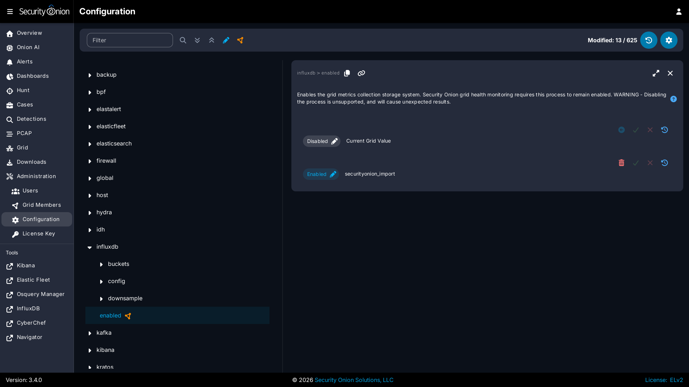
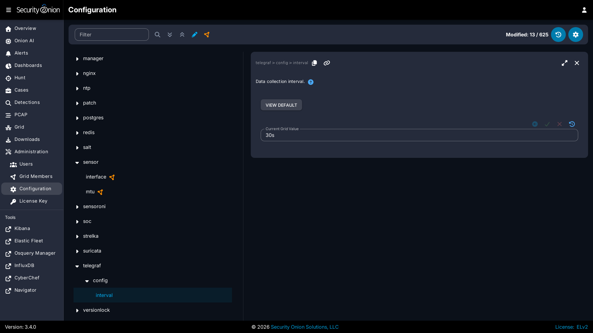

# InfluxDB

[Security Onion Console](security-onion-console.md) includes a link on the sidebar that takes you to InfluxDB.

From <https://github.com/influxdata/influxdb>:

> InfluxDB is an open source time series platform. This includes APIs for storing and querying data, processing it in the background for ETL or monitoring and alerting purposes, user dashboards, and visualizing and exploring the data and more. 

## Authentication

Log into InfluxDB using the same username and password that you use for [SOC](security-onion-console.md).

If you need to reset your InfluxDB password, you can reset your [SOC](security-onion-console.md) password via the [Administration](administration.md) interface which will also update your InfluxDB password.

## Configuration

You can configure InfluxDB by going to [Administration](administration.md) --> Configuration --> influxdb.

You can configure Telegraf by going to [Administration](administration.md) --> Configuration --> telegraf.

### Container Metrics

As of Security Onion 3.4.0, container metrics are collected on the host and then read by Telegraf, rather than being collected by Telegraf's built-in Docker input. This allows the Telegraf container to run without access to the Docker socket.

By default, only the container metrics needed by the Security Onion dashboards in InfluxDB are collected. The remaining metrics that the Docker input previously provided are still available, but are disabled by default.

If you have custom dashboards or queries that need any of those additional metrics, you can enable them individually. Go to [Administration](administration.md) --> Configuration. At the top of the page, click the `Options` menu and then enable the `Show advanced settings` option. Then navigate to telegraf --> container_stats and enable the metrics you need. They are grouped by the measurement they belong to, such as `cpu`, `mem`, `net`, `blkio`, `status` and `health`.

## More Information

!!! NOTE
    
    For more information about InfluxDB, please see <https://github.com/influxdata/influxdb>.
